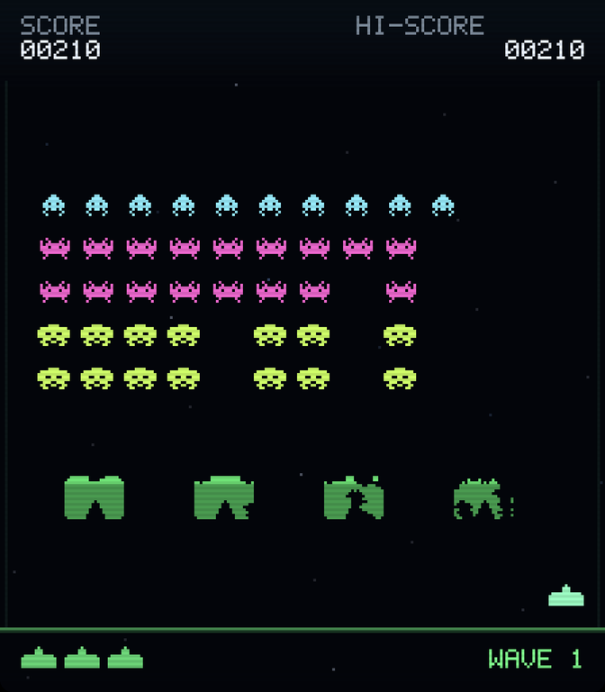
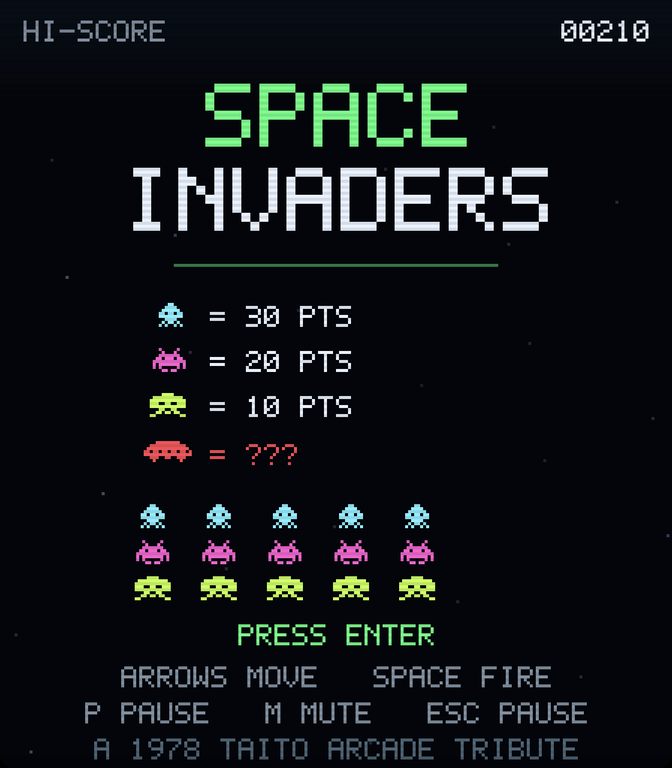

# SPACE INVADERS — Metal Arcade

A complete, native macOS Space Invaders tribute written from scratch in Rust,
rendered entirely with Metal. There are no sprite sheets, no game engine, no
texture assets, and no runtime downloads: the invaders, cannon, bunkers, mystery
ship, pixel font, CRT treatment, application icon, and chiptune sound effects are
all generated in code.

Canonical source: <https://github.com/dlcmh/1978-space-invaders-in-rust-on-macos>





## Play

From a fresh clone:

```bash
git clone https://github.com/dlcmh/1978-space-invaders-in-rust-on-macos.git
cd 1978-space-invaders-in-rust-on-macos
make app
open dist/SPACE-INVADERS.app
```

To produce a distributable disk image as well:

```bash
make dmg
# dist/SPACE-INVADERS-1.0.dmg
```

Generated bundles under `dist/` are intentionally not committed. For development:

```bash
cargo run -p space-invaders-app
```

Requires macOS 13 or newer, a Metal-capable Mac, and a stable Rust toolchain
(1.85 or newer). The project uses the AppKit and Metal frameworks that ship with
macOS; there is no Xcode project and no runtime package manager.

## Controls

| Key | Action |
| --- | --- |
| ← / → or A / D | Move the laser cannon |
| Space | Fire (hold to keep firing) |
| Return | Start game / play again |
| P / Esc | Pause / resume |
| M | Mute / unmute |
| ⌘N | New game |
| ⌘P / ⌘M | Pause / mute (menu shortcuts) |
| ⌃⌘F | Toggle full screen |

The window keeps the arcade screen's 224:256 aspect ratio and is resizable. If
the window is stretched by full screen, the playfield is letterboxed rather than
distorted. Sound can be muted at any time and the setting is remembered.

## What is implemented

- **The canonical 55-invader formation**: five rows of eleven, including 11
  squid (30 points), 22 crab (20 points), and 22 octopus (10 points).
- **The accelerating march**: the formation shifts sideways in two-pixel steps,
  reverses and drops eight pixels at each wall, and steps faster as its numbers
  fall. Animation frames alternate on every step.
- **Player and enemy fire**: one player shot at a time, a descending stream of
  enemy fire from the lowest invader in a column, bullet cancellation, and
  projectile sparks.
- **Four destructible bunkers**: 22 × 16 pixel shields with a rounded roof and
  arched doorway. Both sides' bullets carve ragged, persistent holes; descending
  invaders crush the material they touch.
- **The mystery ship**: a timed bonus target that crosses the top of the screen
  and pays 50, 100, 150, or 300 points from a deterministic fifteen-shot cycle.
- **Arcade scoring and progression**: species scoring, a single bonus life at
  1,500 points, three lives, successive waves that start lower and faster, and a
  persistent local high score.
- **Complete game flow**: attract screen, READY pause, play, pause, death
  animation, wave-clear pause, and game-over/restart screen.
- **A single-draw-call Metal renderer**: one pipeline, 4× MSAA, triple-buffered
  vertex data, letterboxed presentation, animated sprites, a custom 5×7 pixel
  font, a starfield, explosions, and CRT scanlines.
- **Procedural audio**: a polyphonic square/triangle/saw/noise synthesiser driven
  by gameplay events through `AudioToolbox`'s `AudioQueue`, with no audio files.
- **A headless, deterministic simulation** that can be tested without AppKit,
  Metal, or audio.

## Project layout

```text
crates/space-invaders-core/   Pure Rust simulation; no platform dependencies
  src/game.rs                 Rules, state machine, collisions, scoring, events
  src/bunker.rs               Destructible shield grid and crater carving
  src/layout.rs               The 224 × 256 arcade coordinate system
  src/geometry.rs             Rectangles and overlap tests
  src/rng.rs                  Deterministic xorshift64* source
crates/space-invaders-app/    Native macOS executable
  src/app.rs                  AppKit lifecycle, menus, window
  src/view.rs                 NSView, timer, fixed-step loop, keyboard, audio cues
  src/renderer.rs             Metal device, pipeline, buffers, draw call
  src/scene.rs                Frame composition and procedural art direction
  src/canvas.rs               Immediate-mode triangle primitives
  src/sprites.rs              Original ASCII pixel art
  src/pixel_font.rs           5 × 7 vector-pixel font
  src/metal_shaders.rs        Inline Metal Shading Language
  src/audio.rs                AudioQueue output and software synthesiser
  src/preferences.rs          Local high score and mute preference
crates/space-invaders-checks/ Standalone behavior checks over the public API
scripts/                      App bundle, icon generation, docs checker, check gate
Resources/                    Info.plist and generated app icon
Docs/                         Screenshots, origin record, Rust design, Metal course,
                              Q&A entries, and Refactoring decisions
AGENTS.md                     Operating instructions for coding agents
CONTRIBUTING.md               Contribution workflow and quality bar
GOVERNANCE.md                 Decision-making, release, and IP policy
SECURITY.md                   Vulnerability reporting and privacy posture
```

The simulation deliberately does not depend on AppKit, Metal, or audio, so it can
be exercised headlessly and reused by future front ends.

## Verification

```bash
make check
```

`make check` is the gate every change must pass:

1. `cargo fmt --check`
2. `cargo clippy --workspace --all-targets -- -D warnings`
3. `cargo test --workspace`
4. the `SpaceInvadersChecks` behavioral suite
5. a release build of the workspace
6. `python3 scripts/check_docs.py`

The current baseline passes **33 Rust tests** (including the doc test) and
**9,460 behavioral checks**. The checks cover the 55-invader roster, formation
geometry, bunker construction and damage, scoring, clamping, pause, enemy fire,
the long passive round that ends in game over, deterministic replay, and a
7,200-tick input soak. Individual stages are also available as `make test`,
`make checks`, `make lint`, `make fmt`, and `make docs-check`.

Formatting is defined by [`rustfmt.toml`](rustfmt.toml) (`max_width`, edition
2024). Documentation cites a file and a symbol, never a line number; the docs
checker verifies every link, heading anchor, and cited symbol. `make docs-impact`
lists the documents that reference files changed against `HEAD`.

## Rust choices

The implementation is split into a platform-free library, a thin AppKit/Metal
executable, and a checks executable. The simulation has `#![forbid(unsafe_code)]`
and no dependencies. Platform code uses the safe `objc2` bindings for Apple
frameworks; every `unsafe` block is limited to the Objective-C/Metal boundary,
commented with the invariant that makes it sound, and reviewed against the
framework contract.

[`Docs/RUST_DESIGN.md`](Docs/RUST_DESIGN.md) explains the workspace boundary,
the command/snapshot API, the deterministic fixed-step loop, error handling,
the rendering and audio architecture, dependency policy, and the alternatives
that were rejected. [`Docs/METAL_CRASH_COURSE.md`](Docs/METAL_CRASH_COURSE.md)
introduces Metal from first principles using this renderer as the worked example.

## Questions and answers

[`Docs/QnA/`](Docs/QnA/README.md) collects source-grounded answers about the
architecture, the invader march and collisions, the single-draw-call renderer,
and the procedural audio synthesiser. Each entry links to the files and symbols
it describes, and `make docs-check` keeps those references honest.

## Refactoring

[`Docs/Refactoring/`](Docs/Refactoring/README.md) holds dated records of design
decisions and evaluated alternatives. The first entry records why the app uses
the `objc2` bindings directly instead of `winit` plus `metal-rs`.

## Project and governance

- [Project origin](Docs/PROJECT_ORIGIN.md) — the original commission, scope
  decisions, and delivery record
- [Contributing](CONTRIBUTING.md)
- [Governance](GOVERNANCE.md)
- [Security policy](SECURITY.md)
- [Agent instructions](AGENTS.md)

No open-source license has been selected for this repository; see the governance
policy before reusing or redistributing any part of it.

## Notes

SPACE INVADERS is a trademark of TAITO CORPORATION. This is a fan-made,
non-commercial technical tribute and is not affiliated with or endorsed by Taito.
All artwork, audio, and code in this repository are original procedural work. No
arcade ROMs, extracted sprites, fonts, or recorded audio are included.
